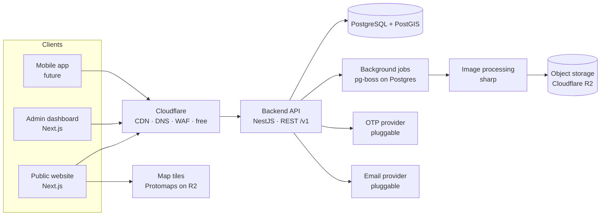

# Platform Architecture & Technology Stack

> Status: **Approved (Q-02, 2026-10-30).**

## 1. Guiding principles

1. **Free first, swappable later.** Every external service (SMS, maps, storage, search, payments, email) is accessed through our own interface, so a free option can be replaced by a paid one without touching business logic (A-05).
2. **API-first.** The website is just one client of the API. The future mobile app uses the same API (G-04).
3. **Modular monolith, not microservices.** One backend codebase split into strict modules (listings, users, locations…). This is far cheaper and simpler to run for a small team, and modules can be split into separate services later if scale requires it. Microservices now would multiply hosting cost and complexity for no benefit.
4. **The database is the foundation.** PostgreSQL with strict constraints, foreign keys and migrations. No "save anything" document stores for core data.
5. **Arabic is not a translation layer.** RTL, Arabic search, Arabic URLs/metadata and Arabic typography are part of every component from the start.
6. **Mainstream, well-documented tools** so future developers can join easily (A-04).

## 2. System overview



## 3. Technology stack

| Layer | Choice | Why | Alternatives considered |
|-------|--------|-----|-------------------------|
| Language | **TypeScript** everywhere | One language for frontend, backend and shared validation. Types catch bugs early. Easiest to hire for. | — |
| Repo structure | **Monorepo** (pnpm workspaces + Turborepo) | Web, admin, API and shared packages live together and share types/validation, so one change updates every app consistently. | Separate repos: harder to keep in sync. |
| Public website | **Next.js** (React, App Router) | Server-rendered pages, so Google indexes every property page; built-in image optimization, localized routing and metadata. | Remix, Nuxt: smaller ecosystems for our needs. |
| Admin dashboard | **Separate Next.js app** (`admin.` subdomain) | Isolated from the public site (security, bundle size), but shares the same UI component library. | Inside the public app: mixes concerns, riskier. |
| Styling | **Tailwind CSS** using *logical properties* (`ms-`, `pe-`, `start-`, `end-`) | RTL/LTR handled by the same classes: no duplicated stylesheets, no "flip later". | CSS-in-JS: slower, weaker RTL tooling. |
| UI primitives | **Radix UI** (accessible headless components) + our own design system | Accessible dropdowns/dialogs that work correctly in RTL, styled with our identity rather than a generic template look. | MUI/Ant: heavy, generic look, harder RTL. |
| i18n | **next-intl** (web) + ICU message format | Proper plurals (Arabic has 6 plural forms), locale-aware numbers/dates/currency, localized routes. | i18next: fine, but less integrated with Next.js. |
| Backend API | **NestJS** (on Fastify) | Enforced modular structure, dependency injection, built-in guards for role-based permissions, automatic OpenAPI docs for the mobile team. A very common framework, so new developers find it familiar. | Express (no structure), Next.js API routes only (poor fit for mobile + jobs + big domain). |
| Database | **PostgreSQL 16+ with PostGIS** | Relational integrity, excellent full-text search, JSONB for flexible attributes, PostGIS for map/radius search. Free and open source. | MySQL: weaker geo & JSON. MongoDB: wrong fit for relational marketplace data. |
| ORM / migrations | **Drizzle ORM** | SQL-close, type-safe, first-class PostGIS column support, versioned migrations. | Prisma: popular but weak PostGIS support (would force raw SQL for map search). |
| Validation | **Zod** schemas in a shared package | The same rules validate the web forms, the admin forms and the API: one definition, no drift. | — |
| Search | **PostgreSQL itself at launch** (indexed filters, trigram + Arabic-normalized full-text, PostGIS) behind a `SearchService` interface | Free, no extra server, comfortably handles hundreds of thousands of listings with proper indexes. When we outgrow it, plug in Meilisearch/OpenSearch behind the same interface. | Elasticsearch/OpenSearch on day one: costly, another system to run. |
| Background jobs | **pg-boss** (job queue stored in Postgres) | Image processing, expiry reminders, duplicate detection, without adding Redis. | BullMQ + Redis: add later if needed. |
| Images | **Cloudflare R2** + **sharp** (resize to AVIF/WebP in several sizes, watermark, strip EXIF/GPS) | R2: 10 GB free and **no bandwidth fees**, which matters for an image-heavy site. Stripping GPS metadata protects owner privacy. | AWS S3 (bandwidth costs), Cloudinary (expensive at scale). |
| Maps | **MapLibre GL** + **Protomaps** vector tiles hosted on R2 (OpenStreetMap data) | Fully free and self-hosted, and looks modern. Behind a `MapProvider` component so Google Maps can replace it later (I-02). | Google Maps now: paid. Leaflet + OSM tile servers: OSM's usage policy forbids heavy commercial use. |
| Auth | Own **auth module**: phone OTP → secure httpOnly cookie sessions (web) / access + refresh tokens (mobile). Staff: email + password (Argon2) + TOTP 2FA | Phone OTP is simple enough to own, so we avoid per-user fees from auth vendors and keep full control. | Auth0/Clerk: monthly cost per user, weaker Iraqi phone support. |
| OTP delivery | `OtpProvider` interface: **console (dev)** → SMS / WhatsApp provider (prod) | Only unavoidable early cost (Q-05). Choose the provider with the best Iraqi deliverability at launch time. | — |
| Email | `MailProvider` interface: Resend free tier (3k/month) | Admin notices, agency invites. | — |
| Errors & monitoring | Sentry (free tier) + structured logs | Know about bugs before users report them. | — |
| Analytics | Umami (self-hosted, free, privacy-friendly) | Traffic stats without Google Analytics cookie banners. | GA4: free but heavier. |
| Testing | **Vitest** (unit/integration), **Playwright** (end-to-end, in Arabic *and* English, mobile *and* desktop viewports) | Playwright is already available in our environment. | — |
| Local dev | **Docker Compose** (Postgres+PostGIS, MinIO as local S3) | Whole platform runs locally for free. | — |

## 4. Backend modules (domain boundaries)

Each module owns its database tables and exposes services; modules never reach into each other's tables directly.

| Module | Responsibility |
|--------|----------------|
| `identity` | OTP login, sessions, tokens, staff 2FA, rate limiting |
| `users` | Profiles, preferences (language, currency), account settings |
| `organizations` | Agencies, developers, membership & agency roles (Owner/Manager/Agent), verification requests (dormant) |
| `locations` | Governorate → city/district → neighbourhood tree, geometry, slugs, translations |
| `catalog` | Property categories, transaction types, **configurable attributes per category**, amenities, title-deed types |
| `listings` | Create/edit, drafts, status lifecycle, expiry, quotas, duplicate detection |
| `media` | Upload, processing pipeline, ordering, cover image |
| `search` | Filtering, sorting, map bounds search, SEO landing page queries |
| `engagement` | Favourites, recently viewed, number reveals, WhatsApp clicks (leads), listing view stats |
| `moderation` | Review queue, approve/reject with reasons, reports, duplicate flags, trust levels |
| `content` | Homepage sections, featured listings/agencies, banners & promo placements, static pages, all with separate AR/EN content |
| `billing` (dormant) | Packages, credits, boosts, invoices, payments via `PaymentProvider` (feature-flagged off) |
| `notifications` | OTP, email, later WhatsApp/push |
| `admin` | Staff accounts, permissions, audit log, platform statistics, settings (exchange rate, quotas, expiry days) |

## 5. Internationalization strategy

**Locales.** `ar` (default), `en`; `ku` (Sorani) added later without schema changes.

**URL structure (decided, Q-03).**
- Arabic is the root: `example.iq/…`; English: `example.iq/en/…`
- Search: `/{purpose}/{category}/{governorate}/{area}`, e.g. `/rent/apartments/baghdad/karrada` and `/en/rent/apartments/baghdad/karrada`
- Listing: `/property/{id}-{slug}`. The ID makes the URL permanent even if the title changes.
- **Decision: Latin slugs in both languages, with Arabic titles, H1s and meta descriptions on Arabic pages.** Reasons: (1) Arabic URLs become long `%D8%B4…` strings when shared on WhatsApp/Facebook, the main sharing channels in Iraq; (2) one URL structure is simpler to maintain and to extend to Kurdish; (3) Google ranks Arabic pages on their Arabic content, and Property Finder and Bayut both use this approach. Each page declares `hreflang` alternates for ar/en.

**UI text.** Never hardcoded. All strings live in message files (`ar.json`, `en.json`) using ICU syntax for plurals/gender. A CI check fails the build if a key is missing in either language.

**Database content.**
- *Admin-managed reference data* (locations, categories, attributes, amenities, homepage content): translatable fields stored as JSONB, e.g. `name: {"ar": "الكرادة", "en": "Karrada"}`. Adding Kurdish = adding a `ku` key, no migration.
- *User-generated listing content*: title/description stored with their language. The advertiser writes in Arabic (default) and can optionally add English. Automatic translation can be added later (paid).
- *Arabic search normalization*: indexed text is normalized (أ/إ/آ → ا, ة → ه, ى → ي, remove tashkeel/tatweel) so "الكراده" finds "الكرادة".

**Direction.** `<html lang="ar" dir="rtl">` per locale. Components use logical CSS only; icons that imply direction (arrows, chevrons, "back") flip, others (phone, map pin, logos) don't. Mixed Arabic/Latin content (prices, phone numbers, emails) is wrapped with proper bidi isolation so numbers never render scrambled.

**Numbers, currency, dates.** Formatted with `Intl` APIs per locale:
- Prices: `250,000 $` / `250,000,000 د.ع` in Arabic; `$250,000` / `IQD 250,000,000` in English. Short forms for cards (e.g. `250 مليون د.ع`, `IQD 250M`).
- Digits: Western by default (Q-04), switchable later.
- Dates: Gregorian calendar, localized month names.
- Phone: stored in E.164 (`+9647XXXXXXXXX`), validated for Iraqi mobile prefixes (075x Korek, 077x Asiacell, 078x/079x Zain), displayed as `0770 123 4567`, always left-to-right.

## 6. Key data-handling decisions

- **Prices:** stored as integer amount + currency code (`USD`/`IQD`) exactly as entered, plus a computed `price_usd_normalized` refreshed whenever the admin updates the exchange rate (E-01). Price-per-unit and rent period stored explicitly (E-02, E-05).
- **Areas:** always stored in m²; the unit the advertiser used is remembered for display (E-02).
- **Configurable attributes:** each category has attribute definitions (type: number/select/multi-select/boolean, required?, filterable?, shown on card?, translations). Listing values stored in typed columns for the most-filtered fields (bedrooms, bathrooms, area, furnished) and JSONB for the rest, indexed with GIN. This lets the admin add a field like "corner plot" or "generator hours" without a developer (E-04), while keeping core filters fast.
- **Location privacy:** exact point stored; public API returns either the exact point or a deterministic offset (~300–700 m, stable per listing) depending on the advertiser's choice (E-09).
- **Soft deletes & audit log:** listings and users are never hard-deleted by default; every admin action is recorded (who, what, when, before/after).

## 7. Security baseline

- Role-based access control: global roles (user, advertiser types, staff roles) + organization roles (agency owner/manager/agent) + fine-grained staff permissions (e.g. `listings.moderate`, `locations.manage`).
- OTP: short expiry, attempt limits, per-phone and per-IP rate limiting, cooldowns, abuse detection.
- httpOnly, Secure, SameSite cookies; CSRF protection; strict CORS; security headers (CSP, HSTS).
- All input validated with Zod at the API boundary; parameterized queries only (via ORM).
- Uploads: type/size validation, re-encoding through sharp (removes malicious payloads and GPS data), private originals.
- Phone numbers protected behind "reveal" endpoints with rate limiting to stop scraping (F-03).
- Secrets only in environment variables; dependencies scanned in CI.
- Cloudflare WAF and bot protection (free tier) in front of everything.

## 8. Environments, hosting & cost

| Environment | Setup | Monthly cost |
|-------------|-------|--------------|
| Local development | Docker Compose on your/our machine | Free |
| Staging | Free tiers (e.g. Neon or Supabase Postgres with PostGIS, Render/Fly free web services, R2 free) | Free (may sleep when idle) |
| Production (launch) | One VPS (e.g. Hetzner/DigitalOcean, 4 GB RAM) running API + web + admin + Postgres in Docker, behind Cloudflare free CDN; R2 for images; nightly DB backups to R2 | ~US$5–15 + OTP usage (Q-05, Q-06) |
| Production (scale) | Managed Postgres, multiple app instances, dedicated search engine, Redis | Grows with traffic and revenue |

Cloudflare's network has data centres in and around Iraq, so cached pages and images load fast even if the server is in Europe.

## 9. Repository layout (planned)

```
apps/
  web/        Public website (Next.js)
  admin/      Admin dashboard (Next.js)
  api/        Backend API (NestJS)
packages/
  ui/         Design system components (RTL/LTR)
  shared/     Zod schemas, types, constants, formatting helpers
  i18n/       Message catalogs (ar, en) + checks
  db/         Drizzle schema, migrations, seed data (locations, categories)
  config/     Shared ESLint/TS/Tailwind config
docs/         This documentation
infra/        Docker Compose, deployment configs
```

## 10. Future-proofing checklist

| Future need | How the architecture prepares for it |
|-------------|--------------------------------------|
| Mobile app | Versioned REST API (`/v1`), OpenAPI spec, token auth path |
| Payments | `PaymentProvider` interface + dormant billing module |
| Subscriptions & boosts | Packages/credits/boost tables exist, feature-flagged off |
| Kurdish language | JSONB translations + message catalogs + RTL already supported |
| Google Maps | `MapProvider` abstraction |
| Dedicated search engine | `SearchService` abstraction |
| In-app chat | `engagement`/`notifications` modules designed to host conversations |
| Developer projects | Developer org type exists; projects module slots in later |
| Document verification | Verification request tables exist, UI switched off |
