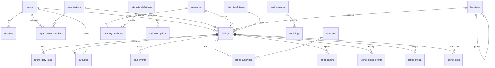
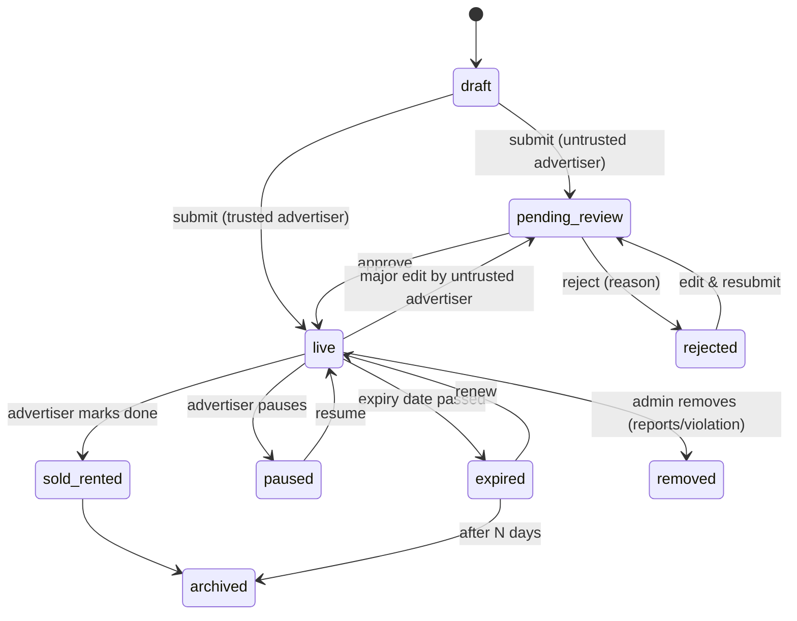

# Database Design

PostgreSQL 16+ with the PostGIS extension, managed with Drizzle ORM migrations.

> Status: **Proposed, awaiting founder approval.** Column lists show the important fields; created/updated timestamps exist on every table and are omitted below for brevity.

## 1. Conventions

| Convention | Rule | Why |
|------------|------|-----|
| Primary keys | `uuid` (v7, time-ordered) for users, organizations, media, etc. `bigint` for **listings** | UUIDs can't be guessed or counted by competitors. Listings use short numeric IDs because they appear in public URLs (`/property/48213-...`) and get read out over the phone. |
| Translatable reference data | `jsonb` like `{"ar": "...", "en": "..."}` | Adding Kurdish (`ku`) later needs no migration (B-02). |
| Money | `bigint` amount in whole units + `currency` (`IQD`/`USD`) | No floating-point rounding errors. IQD has no fractions in practice; USD prices are whole dollars. |
| Areas | `numeric(12,2)` in **m²** | One unit for filtering; the advertiser's unit is remembered for display. |
| Phones | `text` in E.164 (`+9647701234567`) | One canonical format for login, uniqueness, WhatsApp links. |
| Deletion | Soft delete (`deleted_at`) on users, organizations, listings | Recoverable mistakes, audit trail, moderation evidence. |
| Enumerations | Postgres enums for fixed system states (listing status); **tables** for anything admins manage (categories, deed types, amenities) | Admin-managed values must be editable without a developer. |
| Naming | `snake_case`, plural table names | Standard; familiar to new developers. |

## 2. Entity overview

## 3. Identity & accounts

### `users`
Everyone who logs in with a phone number: seekers and all advertiser types.

| Column | Type | Notes |
|--------|------|-------|
| id | uuid PK | |
| phone | text, unique | E.164, verified by OTP |
| phone_verified_at | timestamptz | |
| account_type | enum `seeker`, `owner`, `broker`, `agent`, `developer_rep` | Seekers become `owner`/`broker` when they choose to advertise. `agent` = member of an agency. (C-01) |
| display_name | text | |
| email | text, nullable, unique | Optional, for notifications |
| avatar_media_id | uuid FK → media_files | |
| whatsapp_phone | text, nullable | Defaults to `phone` |
| bio | jsonb | Translatable, for brokers/agents |
| preferred_locale | enum `ar`, `en` | |
| preferred_currency | enum `IQD`, `USD` | Display preference |
| trust_level | enum `new`, `standard`, `trusted` | Drives pre/post moderation (F-01) |
| status | enum `active`, `suspended`, `banned` | |
| free_listing_quota_override | int, nullable | Per-user exception to C-05 |
| last_login_at, deleted_at | timestamptz | |

### `otp_challenges`
| Column | Notes |
|--------|-------|
| id, phone, code_hash | Code stored **hashed**, never in plain text |
| channel | `sms`, `whatsapp`, `console` |
| purpose | `login`, `change_phone` |
| attempts, expires_at, consumed_at, ip_address | Attempt limiting & expiry |

### `sessions`
`id`, `user_id`, `token_hash`, `client` (`web`, `ios`, `android`), `ip_address`, `user_agent`, `expires_at`, `revoked_at`. Refresh tokens for mobile are stored the same way.

### `staff_accounts` (separate from users, on purpose)
Admin staff log in with email + password + authenticator 2FA, on the admin subdomain only. Keeping staff in their own table means a compromised public account can never gain admin rights.

`id`, `email`, `password_hash` (Argon2id), `totp_secret_encrypted`, `name`, `status`, `last_login_at`.

### `staff_roles`, `staff_role_permissions`, `staff_account_roles`
Roles (e.g. *Super admin*, *Moderator*, *Content editor*, *Support*) map to permission strings such as `listings.moderate`, `locations.manage`, `users.suspend`, `content.edit`, `settings.manage`. Permissions are defined in code; roles are editable in admin.

## 4. Organizations (agencies & developers)

### `organizations`
| Column | Notes |
|--------|-------|
| id | uuid |
| type | enum `agency`, `developer` |
| slug | unique, for `/agencies/{slug}` |
| name | jsonb (AR/EN) |
| description | jsonb |
| logo_media_id, cover_media_id | |
| phone, whatsapp_phone, email, website | |
| office_location_id | FK → locations |
| office_address | jsonb (free text, AR/EN) |
| office_point | geography(Point) |
| trust_level, status | Same meaning as users |
| is_verified, verified_at | Dormant until verification launches (C-02) |
| listing_quota | Null = unlimited (free phase) |
| deleted_at | |

### `organization_members`
`organization_id`, `user_id`, `role` (`owner`, `manager`, `agent`), `title` (jsonb), `status` (`invited`, `active`, `removed`), `invited_by`. One user belongs to at most one organization (unique on `user_id` where active).

### `verification_requests` (dormant)
`id`, `subject_type` (`user`/`organization`), `subject_id`, `kind` (`identity`, `trade_license`, `office_registration`, `other`), `documents` (media IDs), `status` (`pending`, `approved`, `rejected`), `reviewed_by`, `review_note`.

## 5. Locations

A single self-referencing table supports any depth, since Iraqi places don't all have the same levels (e.g. Baghdad has many neighbourhoods inside one city; a farm area may sit directly under a district).

### `locations`
| Column | Type | Notes |
|--------|------|-------|
| id | int PK | |
| parent_id | int FK → locations | Null for governorates |
| type | enum `governorate`, `city`, `district`, `neighbourhood`, `compound` | `compound` = residential complexes (مجمعات), e.g. Dream City Erbil |
| slug | text | Latin, unique among siblings (`karrada`) |
| full_slug | text, unique | `baghdad/karrada`, used in URLs |
| name | jsonb | `{"ar":"الكرادة","en":"Karrada"}` |
| alt_names | text[] | Alternative spellings for search (الكراده, Karada, Karradah) |
| ancestor_ids | int[] | All parents, for fast "everything inside Baghdad" queries |
| depth | smallint | |
| center | geography(Point) | Map centering |
| boundary | geography(MultiPolygon), nullable | Filled gradually |
| sort_order | int | |
| is_active | bool | Hidden from site when false |
| is_reviewed | bool | False until a team member checks it (G-01) |
| is_launch_area | bool | Promoted on homepage (B-01) |
| listing_count_cache | int | Updated by background job for "Popular locations" |

## 6. Catalog: categories, attributes, amenities

This is what makes filters adapt to the property type (brief §4) and lets admins add Iraqi-specific fields without developers (E-04).

### `categories`
`id`, `parent_id` (group → type, e.g. *Residential* → *Apartment*), `slug`, `name` (jsonb), `name_plural` (jsonb, for SEO page titles), `icon`, `allowed_purposes` (array of `sale`, `rent`, `key_money`), `sort_order`, `is_active`.

### `attribute_definitions`
| Column | Notes |
|--------|-------|
| id, key | Stable machine key, e.g. `street_width_m`, `corner_plot`, `facing` |
| label | jsonb |
| data_type | `integer`, `decimal`, `boolean`, `select`, `multi_select`, `text` |
| unit | e.g. `m`, `m2`, `years` (nullable) |
| min_value, max_value | Validation |
| storage | `column` (one of the core typed listing columns) or `jsonb` |
| help_text | jsonb |

### `attribute_options`
For select types: `attribute_id`, `value` (key), `label` (jsonb), `sort_order`.

### `category_attributes` (which fields apply to which category)
`category_id`, `attribute_id`, `is_required`, `is_filterable`, `filter_widget` (`range`, `chips`, `toggle`, `dropdown`), `show_on_card`, `show_in_key_facts`, `applies_to_purposes` (e.g. rent-only fields), `sort_order`.

### `amenities`, `category_amenities`
Amenities are simple yes/no features grouped for display (`group`: *Building*, *Utilities*, *Outdoor*, *Security*…). `category_amenities` defines which apply to which category.

### `title_deed_types`
`id`, `key`, `name` (jsonb), `description` (jsonb), `sort_order`, `is_active` (E-03).

The initial content for all catalog tables is in `06-catalog.md`.

## 7. Listings

### `listings`
| Column | Type | Notes |
|--------|------|-------|
| id | bigint identity | Public reference number |
| owner_user_id | uuid FK → users | Who created it |
| organization_id | uuid FK, nullable | If published under an agency/developer |
| assigned_agent_id | uuid FK → users, nullable | Agency lead routing (C-03) |
| category_id | FK → categories | |
| purpose | enum `sale`, `rent`, `key_money` | |
| status | enum (see lifecycle below) | |
| **Location** | | |
| location_id | FK → locations | Most specific level chosen |
| location_ancestor_ids | int[] | Copied from location, GIN-indexed for search |
| point | geography(Point) | **Exact pin, required** (E-09). Never sent to public clients |
| public_point | geography(Point) | Exact or deterministically offset, depending on `location_visibility` |
| location_visibility | enum `exact`, `approximate` | |
| address_note | text, nullable | Private: e.g. محلة 905 زقاق 12, visible to staff only |
| **Price** | | |
| price_amount | bigint | As entered |
| currency | enum `IQD`, `USD` | (E-01) |
| price_basis | enum `total`, `per_m2`, `per_dunam`, `per_olk` | (E-02) |
| price_total_usd_normalized | bigint | Computed total in USD for filtering/sorting; recomputed when the exchange rate changes |
| price_negotiable | bool | "قابل للتفاوض" |
| hide_price | bool | Some advertisers prefer "price on request". Admin-controllable |
| rent_period | enum `monthly`, `yearly`, nullable | (E-05) |
| rent_advance_months | smallint, nullable | |
| tenant_preference | enum `any`, `families`, `singles`, `companies`, nullable | |
| **Core typed attributes** (most filtered → real columns for speed) | | |
| area_m2 | numeric | Built/usable area |
| plot_area_m2 | numeric, nullable | Land area for houses/land |
| area_input_unit | enum `m2`, `dunam`, `olk` | Display in the unit the advertiser used |
| bedrooms | smallint, nullable | 0 = studio |
| bathrooms | smallint, nullable | |
| furnishing | enum `furnished`, `semi_furnished`, `unfurnished`, nullable | |
| condition | enum `new`, `excellent`, `good`, `needs_renovation`, `under_construction`, `shell`, nullable | |
| title_deed_type_id | FK, nullable | Required for sale (enforced in app + check constraint) |
| **Flexible attributes** | | |
| attributes | jsonb | All other category-specific values, keyed by `attribute_definitions.key`. GIN-indexed |
| **Content** | | |
| original_locale | enum `ar`, `en` | Language the advertiser wrote in |
| **Contact** | | |
| contact_phone, contact_whatsapp | text, nullable | Defaults from user/agent |
| **Lifecycle** | | |
| submitted_at, published_at, expires_at, last_renewed_at | timestamptz | (E-08) |
| rejection_reason_id, rejection_note | | |
| is_featured_until | timestamptz, nullable | Admin featuring now, paid boosts later |
| quality_score | smallint | Completeness (photos, description, pin…) used in ranking |
| duplicate_group_id | uuid, nullable | (C-04) |
| search_document | tsvector | Normalized Arabic + English text for keyword search |
| view_count_cache, favourite_count_cache | int | Denormalized counters |
| deleted_at | timestamptz | |

**Listing lifecycle (`status`)**

### `listing_texts`
`listing_id`, `locale` (`ar`, `en`, later `ku`), `title`, `description`, `is_machine_translated`. Unique on (`listing_id`, `locale`). At least the `original_locale` row is required.

### `listing_media`
`id`, `listing_id`, `media_file_id`, `sort_order`, `is_cover`, `caption` (jsonb), `kind` (`photo`, `floor_plan`; `video` later).

### `media_files` (shared by listings, avatars, logos, documents)
`id`, `owner_type`, `owner_id`, `storage_key_original` (private), `variants` (jsonb: sizes → keys), `mime_type`, `width`, `height`, `bytes`, `blurhash` (tiny placeholder shown while loading), `phash` (perceptual hash, for duplicate image detection later), `status` (`uploading`, `processing`, `ready`, `failed`).

### `listing_amenities`
`listing_id`, `amenity_id` (composite PK).

### `listing_status_events`
Full history: `listing_id`, `from_status`, `to_status`, `actor_type` (`user`, `staff`, `system`), `actor_id`, `reason_id`, `note`, `created_at`.

### `rejection_reasons`, `report_reasons`
Admin-managed lists with translatable labels (e.g. *Wrong price*, *Fake listing*, *Already sold*, *Wrong location*, *Poor photos*).

### `listing_reports`
`id`, `listing_id`, `reporter_user_id` (nullable for anonymous), `reporter_ip_hash`, `reason_id`, `message`, `status` (`open`, `actioned`, `dismissed`), `handled_by`, `handled_at`.

### `duplicate_groups`
`id`, `status` (`suspected`, `confirmed`, `dismissed`), `detected_by` (`rule`, `image`, `staff`), `reviewed_by`. Listings point to their group.

## 8. Engagement & statistics

| Table | Columns | Purpose |
|-------|---------|---------|
| `favourites` | user_id, listing_id, created_at | Saved properties (F-04) |
| `recently_viewed` | user_id, listing_id, viewed_at (capped to last 50 per user) | Logged-in users; anonymous users keep this in the browser |
| `lead_events` | id, listing_id, organization_id, agent_id, type (`phone_reveal`, `whatsapp_click`, `call_click`, `share`), user_id (nullable), session_hash, created_at | Leads for advertiser stats (F-02, F-03) |
| `listing_daily_stats` | listing_id, date, views, unique_views, phone_reveals, whatsapp_clicks, favourites | Aggregated nightly from raw events: fast dashboards, small storage |

Raw page views are counted through a lightweight endpoint and aggregated, not stored row by row forever.

## 9. Content & promotion (admin-managed)

| Table | Purpose |
|-------|---------|
| `homepage_sections` | Ordered sections (hero, featured listings, popular locations, agencies, CTA banners), each with `locale_content` jsonb so AR and EN are edited **independently** (brief §6) |
| `featured_placements` | `target_type` (`listing`, `organization`, `location`), `target_id`, `placement` (`home_featured`, `search_top`, `home_agencies`), `starts_at`, `ends_at`, `source` (`admin`, later `paid`) |
| `banners` | Promotional/ad placements: `slot`, `image_media_id` per locale, `link_url`, `starts_at`, `ends_at`, impressions/clicks counters |
| `static_pages` | About, Terms, Privacy, Help: `slug`, `title` and `body` per locale |

## 10. Platform settings & audit

| Table | Purpose |
|-------|---------|
| `settings` | Key/value jsonb: `listing_expiry_days` (60), `owner_free_listing_limit` (3), `feature_flags`, `contact_whatsapp_support`… |
| `exchange_rates` | History of `usd_to_iqd` rates with `effective_from` and `set_by`. Current rate = latest row |
| `audit_logs` | `actor_type`, `actor_id`, `action` (`listing.approve`, `user.suspend`…), `entity_type`, `entity_id`, `before`/`after` jsonb, `ip_address`, `created_at`. Append-only |

## 11. Billing (built later, designed now: D-02)

Tables are created when billing starts, but the listing/organization tables above already have the hooks they need (`listing_quota`, `is_featured_until`, `featured_placements.source`).

| Table | Purpose |
|-------|---------|
| `packages` | Sellable products: subscription plans (listing slots per month), boost types (Featured, Premium, Refresh), credit bundles. Prices in IQD/USD |
| `subscriptions` | Organization ↔ package, period, status, auto-renew |
| `credit_ledger` | Append-only ledger of credits added/spent (never a single editable "balance" number: auditable) |
| `listing_boosts` | Which boost is applied to which listing, from/until |
| `invoices`, `invoice_lines` | Including manual (cash/transfer) invoices recorded by admin (D-03, D-04) |
| `payments` | `provider` (`manual`, `zaincash`, `card`…), `provider_reference`, `status`, raw payload |

## 12. Search & performance strategy

The most common query is: *live listings, purpose X, category Y, inside location Z, price between A and B, sorted by newest / price*.

| Index | Purpose |
|-------|---------|
| Partial B-tree on `(purpose, category_id, published_at DESC) WHERE status = 'live'` | Default listing pages |
| Partial B-tree on `(purpose, category_id, price_total_usd_normalized) WHERE status = 'live'` | Price filter + sort |
| GIN on `location_ancestor_ids` | "In Baghdad" includes every neighbourhood inside |
| GiST on `public_point` | Map view: listings inside the visible map area |
| GIN on `attributes` (`jsonb_path_ops`) | Category-specific filters |
| GIN on `search_document` + trigram on location names | Keyword & location autocomplete with Arabic normalization |
| B-tree on `(status, expires_at)` | Expiry job |
| B-tree on `owner_user_id`, `organization_id` | Dashboards |

- Only `live` listings are searched, and partial indexes keep the indexes small.
- Counts per filter ("Apartments (1,240)") are cached briefly.
- Everything goes through `SearchService`, so moving to Meilisearch/OpenSearch later doesn't touch the website.
- Expected comfortable capacity on this design: several hundred thousand live listings on a modest server.

## 13. Data integrity rules (enforced in the database, not just the app)

- Foreign keys everywhere; no orphaned images, listings or members.
- Check constraints: `price_amount > 0` unless `hide_price`; `rent_period` required when `purpose = 'rent'`; `bedrooms BETWEEN 0 AND 50`; area > 0.
- Unique constraints: phone per user; one active organization per user; one favourite per user/listing; one text per listing/locale.
- Owner quota (C-05) is enforced in a transaction when a listing goes live, so two quick submissions can't bypass it.
- Advertisers never edit `status` directly; status changes only through the lifecycle service, which writes `listing_status_events`.
